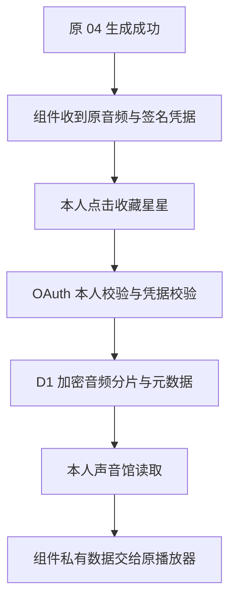

# 电脑自然版 04：银色播放器与本人私有收藏

本次仅在 `codex/desktop-04-private-favorites-20261111` 施工。基线为核验到的线上自然版 `74818d5caa8dde190963445b65c4ca1730524fa8`，对应 `deploy/desktop-04-v1`。没有修改该部署分支、Render 配置或云端数据库，没有调用真实 MiniMax。

## 范围与外观

银色低矮机身、弱竖纹、中浅银灰头像框、白色显示屏；深灰「沈述」与浅灰 `for Nuonuo` 分层。右侧保留播放/暂停，下面使用浅银灰五角星，收藏后为灰粉色。播放时显示一次小爱心与 Mwah。保留原播放函数、Web Audio 解码、停止行为、进度计算和时长。波形为装饰动画，不是新增音频分析器；进度条沿用只读行为，不新增拖动跳播。

头像采用已选定的黑窗版原图，原字节内嵌于受认证保护的组件资源，不增加外部图片请求。完整回复仍显示在播放器下方。

收藏为显式操作：生成成功后点击星星，才保存这次已收到的音频。声音馆按生成时间倒序，每页 10 条，仅有列表、载入播放、取消收藏。载入后点击上方原播放按钮，保留已有的直接点击播放行为，避免新增宿主自动播放依赖。

## 现有声音馆复用依据

已检查 `nuonuo310/ShenShu-Voice` 的 `3c8a9e62877294fa4cea7e196806a1fb9ee47f17`：

| 原位置 | 已有结构 | 本次处理 |
| --- | --- | --- |
| `packages/voice-data/index.js` | `id/title/date/category/duration/audioUrl/body/captions/demo` | 复用 `id/title/date/duration/body/captions/demo` 字段语义；增加精确 `createdAt`；不写公开 `audioUrl` |
| `packages/voice-data/local-audio.js` | IndexedDB `shenshu:local-audio` / `recordings`，存 Blob、文字和日期 | 确认为浏览器本地录音存储，无服务端本人权限；不能直接作为 ChatGPT 私有持久存储 |
| `apps/voice-gallery/main.js` | 原声音馆页面、`shenshu:favorites` 本地 ID 数组及较完整的管理功能 | 沿用收藏/查看/播放的语义，不复制搜索分类等大页面，也不改该仓库 |

因此新增的是现有 MCP 内的本人私有持久化适配层和最小视图，没有另建站点、账号、桶或公开音频服务。旧站本机收藏不会被自动搬运；旧聊天里没有收藏凭据的历史音频仍能播放，但本版不能追溯保存已丢失的音频。

## 数据流与权限



- 生成工具只增加一个失败可忽略的签名凭据；不在生成时保存收藏、不改变原生成结果和失败重试规则。凭据绑定 OAuth 本人、稳定 `voice_…` ID、完整文字、原 WAV 摘要与生成成功时间。
- 收藏请求上传组件已持有的 WAV，经过原 WAV 格式/体积/时长契约验证。服务端不接受调用方指定本人身份。每次 MCP 请求先验证现有 OAuth，再用服务端确认的 principal 查询。
- `voice_favorites` 以 `(principal,id)` 为主键，含生成时间、上传批次、分片数、加密元数据；`voice_favorite_parts` 存加密 WAV 分片。AES-256-GCM 的附加认证数据绑定本人、ID 和用途。使用现有文本主密钥，经独立 HKDF 上下文派生收藏密钥与凭据密钥；不新增密钥或放宽权限。
- 先写全部分片，再发布单条完整清单。重复保存保留同一 ID，不产生重复收藏。断网/超时不发布残缺音频。最大 60 秒 WAV 的读取每次最多三个 64,000 字符分片，保持在现有 D1 HTTP 262,144 字节响应上限内。
- 完整文字、列表详情和音频只放在组件专用 `_meta`；模型可见结果只有通用操作状态和保存 ID。存取/取消工具标记为仅 app 使用；只有「打开沈述声音馆」可由模型发起。服务端签名和本人查询是实际权限边界，工具可见性不是唯一防线。
- 不创建永久音频 URL，不经过七牛，不使用公开桶或公开下载接口。数据库管理员仍可看到本人标识、ID、时间、长度等元数据；拥有运行服务及主密钥的运维者能够解密。本人私有指应用用户之间隔离，不声称端到端加密。
- 取消收藏删除清单及其音频分片；已在当前播放器内存中的音频仍可播放。收藏失败只更新提示，不停止播放、不清除现有音频，也没有任何调用 MiniMax、生成工具、额度表或授权扣账表的路径。

## 改动文件

| 文件 | 用途 |
| --- | --- |
| `src/private-voice-collection.js` | 签名、加密存储、本人查询、分页、收藏工具 |
| `db/d1/007_private_voice_favorites.sql` | 两张新增表、分页索引、取消收藏清理触发器 |
| `src/desktop-collection-runtime.js` | 默认关闭的可选适配层，初始化失败与原生成隔离 |
| `server.js`、`src/protected-resource-shell.js`、`src/staging-authenticated-mcp.js` | 在原认证边界内注入收藏工具；成功音频附加凭据；按开关选择桌面 UI |
| `src/desktop-silver-ui.js`、`ui/desktop-silver.css`、`ui/desktop-collection.js`、`ui/assets/shen-avatar.jpeg` | 桌面银色外观、星星与最小声音馆，复用原播放器 |
| `scripts/preview-desktop-collection.mjs` | 仅本地的合成提示音预览，支持导出单 HTML |
| `test/private-voice-collection.test.js`、`test/desktop-collection-mcp.test.js`、`test/desktop-collection-ui.test.js`、`test/desktop-preview-export.test.js` | 持久化、权限、加密、故障隔离及真实 UI 模块交互测试 |
| `package.json`、`package-lock.json` | 仅增加测试用 jsdom；生产依赖版本未改 |

以下主链路文件与基线逐字相同：`ui/mcp-bubble.html`、`src/minimax-adapter.js`、`src/live-voice.js`、`src/v1-desktop-direct-04-offline.js`、`src/v1-desktop-04-staging-runtime.js`。没有改模型、voice ID、自然版参数、每日额度和按请求生成策略。

## 离线验证及预览

已通过：`npm test` 503/503（原 484 + 新增 19）；`npm audit --omit=dev --audit-level=high` 无漏洞；`node test/smoke-server.mjs`；`git diff --check`。

新增测试覆盖：重开 SQLite 数据库后读取原 WAV/完整文字/原时间；跨本人拒绝读取和凭据重放；内容/签名/时间篡改；并发与重试幂等；部分上传失败；密文篡改；最大 WAV 与真实响应大小边界；同时间分页；组件私有数据边界；凭据失败保留原生成结果；收藏失败保留正在播放的源；重建 UI 后列表、载入及取消收藏；文本安全渲染。

导出可直接打开的预览：

```bash
mkdir -p preview
node scripts/preview-desktop-collection.mjs --export preview/offline-player.html
```

此文件只含明确标注的合成提示音、虚拟宿主和本机演示收藏，不是 04 试听、云端持久化或官端验收。也可运行脚本不带参数，在本机 `http://127.0.0.1:3188/` 连接真实收藏适配层与内存 SQLite。预览服务器仅绑定回环地址，禁止部署；内存演示库仅在进程运行期间保留。

后续预览修正：用户在内嵌 HTML 中遇到“正在收藏”直到超时。原因是旧演示只模拟自己的 `window.postMessage`，但组件原请求发向真实父窗口；此前顶层测试的 `parent===self` 漏掉此问题。现在仅在预览导出中将请求和来源检查绑定到演示自己的窗口，生产 MCP 父窗口通信不变。新增“父窗口非自身”和“浏览器拒绝本机存储”两项回归；存储受限时明确标注“收藏仅本次演示”，不伪称刷新后保留。去掉头像 S · N，聊天版宽度从 580px 收到 460px，机身高度约从 156px 收到 122px，保留白屏、标题层级及实际按钮点击区域。

官端接续（2026-11-11）：用户在专用 D1 控制台回传了两表、索引、触发器四行结果；`78e666c…` 已实际部署，声音馆不计费读取成功，用户截图确认银色界面与空列表。随后唯一一次获授权的真实语音请求显示旧金色卡片，有 4 秒音频，但没有收藏星星，不能算收藏验收通过，也不能为修外观重新生成。服务器仍运行正确候选；旧 speak/prepare 描述与银色声音馆复用了旧资源 URI，宿主缓存是当前解释，尚无宿主内部缓存证据。修正为仅在银色开关开启时，把 speak、prepare、声音馆都指向新的 `ui://shenshu/desktop-04-silver-collection-v1.html`；旧 URI 保持旧界面以兼容旧卡片。修改仅涉及界面资源选择，不改生成、授权和播放链。新增资源选择、旧卡片兼容、回退拒绝新资源回归；空声音馆文案同步改为“选择一段收藏后，可在上方播放”。需要重新部署该修正并刷新工具，再以不计费声音馆验证新资源；已有旧卡片音频只能保留在当前卡片播放，本次没有读取或重新合成它，真实收藏/刷新重播仍待验收。

部署操作记录：实测 Render 的环境变量更新连接即使服务 Auto-Deploy 为 off，也会自动触发原部署分支的构建。第一次更新候选批准 SHA 后，旧版曾因 SHA 不匹配未挂载 04；已将批准 SHA 恢复为旧版并等到恢复部署 live，日志确认 `desktop04_ready`、on-request 开启、每日 10 条。随后用户在控制台 Save only 并指定 `78e666c…` 部署，服务正常挂载。后续批准 SHA 必须在控制台 **Save only**，紧接着 **Deploy a specific commit**；不要再次使用该自动触发部署的连接去更新批准 SHA，也不要触发仍指向旧分支的 Deploy latest commit。

当前远程预览浏览器不能连接该执行环境的回环服务，且安全策略禁止打开本地 `file:` 页面，因此没有完成浏览器截图级视觉验收。DOM 交互测试已经执行；最终白底排版和官端实际播放仍需部署候选验证，不用离线通过冒充官端验收。

## 后续上线步骤（本轮均未执行）

1. 审阅本独立分支和 HTML 预览。为候选服务做数据库备份，确认它指向预期的 D1，并只应用 `007_private_voice_favorites.sql`；不重跑或修改扣费迁移。
2. 先在独立候选服务中开启 `SHENSHU_DESKTOP_04_SILVER_UI_ENABLED=1` 和 `SHENSHU_VOICE_COLLECTION_ENABLED=1`。复用已有主密钥、D1 配置和 OAuth；不改 MiniMax 参数、额度或现有付费开关。沿用现有部署 SHA 校验流程，将候选服务的 `SHENSHU_STAGING_APPROVED_SHA` 对齐实际候选 commit，不能绕过校验。
3. 用非计费候选数据检查认证、两种体积传输、加密收藏、刷新/服务重启后读取、第二账号拒绝访问和取消收藏。确认 D1 触发器及最大分片在真实云端可用。本轮只运行 SQLite 等价离线测试，未做真实云 D1 写入。
4. 刷新 ChatGPT MCP 工具后打开新组件；旧消息卡片不会自动变成新皮肤。检查银色头像、白屏层级、星星状态、声音馆与原播放按钮。未取得收藏凭据时，星星禁用但仍能播放。
5. 仅在新一次明确语音请求获授权后验证自然版 04 的一次真实生成及收藏，不为测试自动合成，也不因收藏失败重新生成。已收藏条目的重播只读原 WAV。
6. 候选验收通过后，另行批准将提交上线。回退 UI/收藏只需关闭两个新开关或回退原版本，保留收藏表；不要删除表或更换已有主密钥。主密钥轮换需要另做迁移，否则旧收藏不可解密。

存储边界：完整上传后已发布的数据保留到本人取消收藏；首版不新增搜索、分类、批量、自动清理服务。中断写入可能留下未发布的加密分片，它们不会出现在列表。需要运维清理时，只删除一天前且没有任何清单引用的分片；保留 `NOT EXISTS` 保护，不能按 ID 盲删：

```sql
DELETE FROM voice_favorite_parts AS p
WHERE p.staged_at < ?
AND NOT EXISTS (
  SELECT 1 FROM voice_favorites AS f
  WHERE f.principal=p.principal AND f.id=p.id AND f.upload_id=p.upload_id
);
```

参数为服务端计算的“一天前”的 ISO 时间。该维护操作未加入线上任务，也未在本轮执行。
